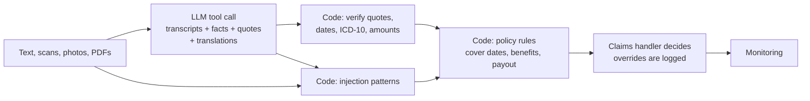

# Claim Triage Desk

A working prototype of an AI service for life and accident insurance claims. A language model reads the claim documents, including flatbed scans and phone photos, in Czech, Ukrainian, Russian, German and English, and has to quote the exact source of every fact. Code verifies each quote, checks the policy terms and calculates the payout. A claims handler makes the decision.

**Live:** [desk](https://sanzhar.sanzarsagyn.workers.dev/claims/) · [API](https://sanzhar.sanzarsagyn.workers.dev/claims/api.html) · [monitoring](https://sanzhar.sanzarsagyn.workers.dev/claims/ops.html) · **Author:** Sanzhar Sagyn · All people, documents and policy terms are fictional.

## Why it is built this way

| Decision | Reason |
| --- | --- |
| The model extracts, it never decides | Paying money has consequences for a client. The model is good at reading messy multilingual paperwork; the decision stays with a person who sees the evidence. |
| Every fact must carry a quote, and code checks it | A value whose quote is not in the document is rejected and shown, never silently fixed. This catches invented values without trusting the model's own confidence. |
| Scans are transcribed by the model, then checked like text | An image has no text to check a quote against. So the model first writes out the whole page, every quote is verified against that transcription, and the handler sees the transcription next to the original. |
| Policy rules are plain code | Payouts must be identical every time and explainable to a client or a regulator. `public/lib/core.js` is unit-tested and runs in both the browser and the Worker. |
| Documents are untrusted input | Pattern rules and the model both look for text addressed to an AI or a reviewer. Either finding escalates the claim. Two test claims contain such instructions. |
| An API first, the page second | The desk is one client of a versioned API described in OpenAPI 3.1. A Python client and its integration tests show how a claims system would call it. |
| Watched, not just deployed | Each model run updates daily counters: runs, latency, cost, rejected quotes, flagged instructions, and how often handlers override the AI. |
| Costs are designed | Visitors' own documents always run on the low-cost model, sample runs are cached, own runs are limited per IP, and a daily budget stops all calls. Uploaded files are never stored. |

## How it works



- `src/extract.js` builds the request (system prompt, JSON schema, `record_extraction` tool call, images and PDFs as content blocks) and validates the answer.
- `public/lib/core.js` holds everything deterministic: quote matching, field validation, injection screening, policy checks, payout and recommendation.
- `src/worker.js` is the Cloudflare Worker: static site, `/api/v1/extract`, `/api/v1/health`, `/api/v1/feedback`, `/api/v1/metrics`, KV cache, rate limits, daily budget. `src/openapi.js` describes the API.
- `public/claims/samples.js` holds 11 claims with 33 documents and reference labels, used by the page, the Worker and the evaluation. Two documents are images, rendered from text by `tools/make-scans.mjs` and degraded into a flatbed scan and a phone photo by `tools/degrade.py`.
- `examples/claimdesk_client.py` is a dependency-free Python client; `examples/test_client.py` tests it against the local server on every commit.

## Evaluation

`node eval/run.mjs https://sanzhar.sanzarsagyn.workers.dev` sends every test claim through the deployed API once per model (Claude Haiku 5.5 and Claude Sonnet 5.5) and scores the answers against the reference labels:

- precision and recall of extracted facts, overall, per field type and on scanned documents;
- how many facts the validation layer rejected;
- whether both planted injections were caught, and false flags on the clean documents;
- whether the final recommendation matches the expected one;
- model time, tokens and cost per claim.

The latest numbers are in [eval/RESULTS.md](eval/RESULTS.md) and on the live page. The test set is synthetic and deliberately awkward: relative dates ("včera", "сьогодні вранці"), OCR errors (`2l. 5. 2026`, `S42.O`), a scan and a tilted phone photo, distractor dates (birth dates, follow-up appointments, X-ray dates), an old fracture with its ICD-10 code in the medical history, German documents with euro amounts, a date before cover started, a sick leave for a different diagnosis, an invoice that does not add up, and two prompt injections. A real deployment would add a labelled set of anonymised real claims.

## Run it

```bash
npm test                          # unit tests: rules, validation, Worker with a mocked model, scoring
node tests/dev-server.mjs         # local site on http://localhost:8790 with a mock model (no key, no cost)
node tests/e2e.mjs                # browser tests against the local site (needs Playwright)
CLAIMDESK_URL=http://localhost:8790 python -m unittest discover -s examples -v   # Python client against the local site
npx wrangler deploy               # deploy to Cloudflare
npx wrangler secret put ANTHROPIC_API_KEY   # switch on live mode
node eval/run.mjs https://<worker>.workers.dev
```

## What production would need

- An EU-hosted model inside the insurer's own cloud tenant: medical reports are special-category data under GDPR.
- Authentication through the insurer's API gateway and identity provider instead of open access with rate limits.
- Policy terms from the policy administration system instead of constants.
- A labelled set of real, anonymised claims, re-run on every prompt or model change before release, with a confidence threshold below which a person always reviews.
- Metrics in a real store with alerting, and override rates broken down by field and claim type.
- Asynchronous processing for long PDFs.

Built with AI coding tools (Claude). Requirements, design decisions, test scenarios and review by Sanzhar Sagyn.
