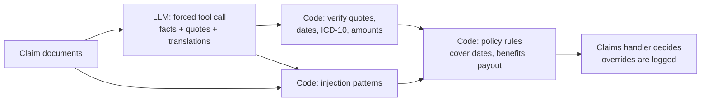

# Claim Triage Desk

A working prototype for life and accident insurance claims. A language model reads the claim documents (Czech, Ukrainian, Russian, English) and has to quote the exact source of every fact. Code verifies each quote, checks the policy terms and calculates the payout. A claims handler makes the decision.

**Live:** https://sanzhar.sanzarsagyn.workers.dev/claims/ · **Author:** Sanzhar Sagyn · All people, documents and policy terms are fictional.

## Why it is built this way

| Decision | Reason |
| --- | --- |
| The model extracts, it never decides | Paying money has consequences for a client. The model is good at reading messy multilingual paperwork; the decision stays with a person who sees the evidence. |
| Every fact must carry a quote, and code checks it | A value whose quote is not in the document is rejected and shown, never silently fixed. This catches invented values without trusting the model's own confidence. |
| Policy rules are plain code | Payouts must be identical every time and explainable to a client or a regulator. `public/lib/core.js` is unit-tested and runs in both the browser and the Worker. |
| Documents are untrusted input | Pattern rules and the model both look for text addressed to an AI or a reviewer. Either finding escalates the claim. Two test claims contain such instructions. |
| Costs are designed | Visitors' own text always runs on the low-cost model, sample runs are cached, own-text runs are limited per IP, and a daily budget stops all calls. |

## How it works



- `src/extract.js` builds the request (system prompt, JSON schema, forced `record_extraction` tool call) and validates the answer.
- `public/lib/core.js` holds everything deterministic: quote matching, field validation, injection screening, policy checks, payout and recommendation.
- `src/worker.js` is the Cloudflare Worker: static site, `GET /api/health`, `POST /api/extract`, KV cache, rate limits, daily budget.
- `public/claims/samples.js` holds 8 claims with 24 documents and reference labels, used by the page, the Worker and the evaluation.

## Evaluation

`node eval/run.mjs https://sanzhar.sanzarsagyn.workers.dev` sends every test claim through the deployed API once per model (Claude Haiku 5.5 and Claude Sonnet 5.5) and scores the answers against the reference labels:

- precision and recall of extracted facts, overall and per field type;
- how many facts the validation layer rejected;
- whether both planted injections were caught, and false flags on the 22 clean documents;
- whether the final recommendation matches the expected one;
- model time, tokens and cost per claim.

The latest numbers are in [eval/RESULTS.md](eval/RESULTS.md) and on the live page. The test set deliberately includes relative dates ("včera", "сьогодні вранці"), OCR errors (`2l. 5. 2026`, `S42.O`), a date that falls before cover started, a sick leave issued for a different diagnosis, an invoice that does not add up, and two prompt injections.

## Run it

```bash
npm test                          # unit tests: rules, validation, Worker with a mocked model, scoring
node tests/dev-server.mjs         # local site on http://localhost:8790 with a mock model (no key, no cost)
node tests/e2e.mjs                # browser tests against the local site (needs Playwright)
npx wrangler deploy               # deploy to Cloudflare
npx wrangler secret put ANTHROPIC_API_KEY   # switch on live mode
node eval/run.mjs https://<worker>.workers.dev
```

## What production would need

- OCR for scanned documents and photos, with the OCR confidence passed to the model.
- An EU-hosted model inside the insurer's own cloud tenant: medical reports are special-category data under GDPR.
- Policy terms from the policy administration system instead of constants.
- A labelled set of real, anonymised claims, re-run on every prompt or model change, with a threshold below which a person always reviews.
- Monitoring of how often handlers override the AI, by field and by claim type.

Built with AI coding tools (Claude). Requirements, design decisions, test scenarios and review by Sanzhar Sagyn.
